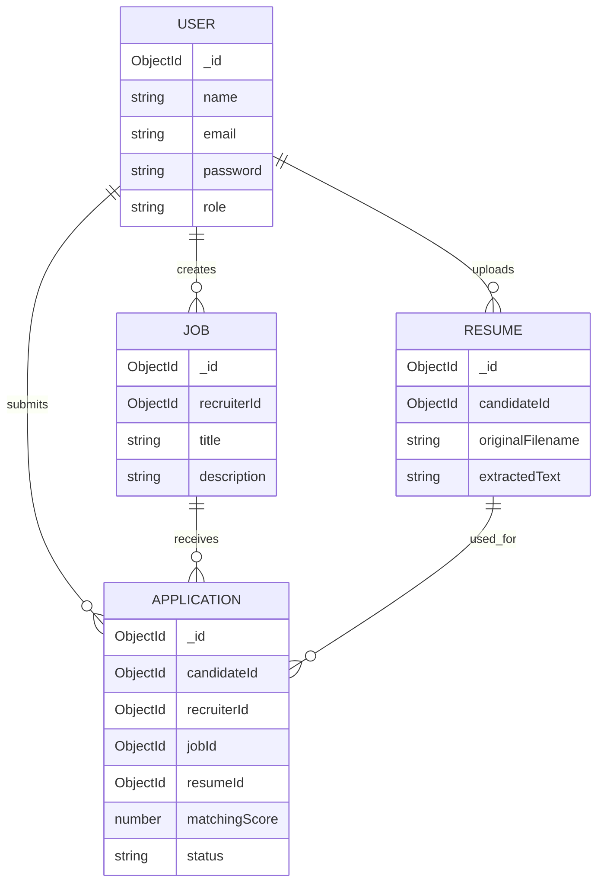

# Database Design

## Collections and relationships

## Indexes
- User email unique index.
- Application compound unique index on candidateId + jobId to prevent duplicate applications.
- Job recruiterId index.
- Resume candidateId index.

Passwords are stored as bcrypt hashes. Resume extracted text is excluded from default Resume query projections and explicitly selected only during screening.
