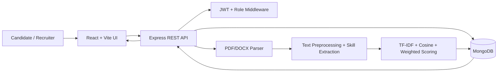

# AI-Powered Resume Screening and Candidate Ranking System

**Student name:** [Your name]  
**Roll number:** [Your roll number]  
**Department:** [Department]  
**Course:** MERN Stack  
**Institution:** [Institution name]  
**Project guide:** [Faculty name]  
**Academic year:** [Year]

## Abstract
Recruitment teams may receive many resumes for a single opening. Manually reviewing every document can be time-consuming and inconsistent. This project presents TalentLens, a MERN-stack web application that supports the initial review process by extracting resume text, identifying technical skills, comparing candidate evidence with job requirements, and producing explainable matching scores. The system provides separate recruiter and candidate experiences, job management, resume upload, application tracking, candidate ranking and analytics. The screening engine uses text normalization, skill synonym mapping, TF-IDF-based cosine similarity and a weighted rule-based score. It is designed as decision support rather than an automated hiring authority. Recruiters must verify extracted information and make final decisions.

## 1. Introduction
Applicant tracking and resume screening are important parts of modern recruitment. A structured digital workflow can make candidate information easier to search and compare. TalentLens combines a React interface, Express REST API, Node.js services and MongoDB persistence. Its NLP-inspired matching service compares a resume with the requirements of a particular job and explains the evidence contributing to the score.

## 2. Problem statement
Manual resume screening can be slow, repetitive and difficult to standardize across a large applicant pool. Recruiters need a system that organizes candidate information and provides consistent, job-specific evidence to support human review.

## 3. Objectives
- Build a full-stack MERN recruitment application.
- Support secure recruiter and candidate accounts.
- Allow recruiters to publish and manage job descriptions.
- Accept PDF and DOCX resumes and extract readable text.
- Identify resume skills and relevant sections.
- Calculate explainable job-specific matching scores.
- Rank and manage applications.
- Provide application analytics and documentation.

## 4. Existing and proposed systems
**Existing approach:** Manual resume review, spreadsheets and unstructured email-based tracking can make it difficult to compare candidates consistently.

**Proposed approach:** A centralized web application stores jobs, resumes and applications. A transparent matching engine identifies skill overlap, missing requirements and text similarity. The recruiter remains responsible for reviewing evidence and making decisions.

## 5. Scope
The project covers user authentication, role-based access, job management, text-based PDF/DOCX parsing, basic structured extraction, NLP-inspired matching, candidate/application management and dashboard analytics. It is an academic prototype and is not a validated hiring assessment or production ATS.

## 6. Requirements
**Functional:** registration/login; recruiter and candidate roles; CRUD job management; resume upload; text extraction; skill extraction; matching and ranking; application status updates; dashboard statistics.

**Non-functional:** maintainability, usability, responsive layout, basic security controls, input validation, modularity and reasonable performance for a classroom demonstration dataset.

**Software:** Node.js, npm, React, Vite, Express, MongoDB, Mongoose, JavaScript, Tailwind CSS, PDF Parse and Mammoth.

**Hardware:** A modern laptop/desktop with 8 GB RAM recommended, internet access for initial dependency installation, and local MongoDB or MongoDB Atlas.

## 7. System architecture

## 8. Main modules
1. **Authentication:** bcrypt password hashing, JWT authentication and role checks.
2. **Job management:** recruiter-created job records with required/preferred skills and experience.
3. **Resume processing:** upload validation, PDF/DOCX text extraction and pattern-based profile extraction.
4. **Screening engine:** skill normalization, skill coverage, experience/qualification evidence and TF-IDF cosine similarity.
5. **Application workflow:** duplicate prevention, application history and recruiter status updates.
6. **Analytics:** counts of active jobs, applications, processed resumes and status distribution.

## 9. Database design
- **User:** name, email, password hash, role, phone, timestamps.
- **Job:** recruiter reference, title, company, description, required/preferred skills, experience range, qualification, location, status.
- **Resume:** candidate reference, filenames, type, size, extracted text, extracted information, processing status.
- **Application:** candidate, recruiter, job and resume references, score, score breakdown, matched/missing/additional skills, explanation and status.

## 10. AI/NLP methodology
**Preprocessing:** convert text to lowercase, normalize punctuation and whitespace, tokenize, remove common stop words and map common skill aliases (for example, ReactJS to React and JS to JavaScript).

**TF-IDF:** for term t in document d, a common form is `TF-IDF(t,d) = TF(t,d) × IDF(t)`, where `IDF(t) = log((N+1)/(DF(t)+1)) + 1`. Here N is the number of compared documents and DF is the number of documents containing the term.

**Cosine similarity:** `cos(A,B) = (A · B) / (||A|| × ||B||)`. It measures the angle-based similarity between document vectors. A zero-vector comparison is safely treated as zero.

**Weighted score:** `Final = 0.45R + 0.15P + 0.15E + 0.10Q + 0.15T`, where R is required-skill coverage, P preferred-skill coverage, E experience fit, Q qualification evidence and T text similarity. Each component is normalized to 0–100. Weights are configurable in source code and are illustrative design choices, not empirically validated coefficients.

**Explainability:** the result returns matched required skills, missing required skills, additional skills, component scores and a plain-language explanation. Absence of a keyword is not proof that a person lacks a skill.

## 11. Implementation
The React client communicates with Express endpoints using Axios. The backend validates requests, checks JWT identity and role, accesses MongoDB using Mongoose, and stores uploaded documents under a generated filename. Resume parsing is performed server-side. The matching engine is a separate JavaScript service so it can be tested independently.

## 12. Testing
Automated Node tests cover relative score ordering, missing-skill explanation and score boundaries. Before submission, perform manual integration tests for registration, login, job creation, upload of sample PDF/DOCX documents, applying to a job, recruiter review, status updates and analytics. Record actual observed outcomes in the testing report; do not invent pass results.

## 13. Limitations
Scanned PDFs require OCR and are not parsed by the current implementation. Resume extraction uses patterns and known skill terms, so unusual layouts may produce incomplete results. Experience and qualification estimates are heuristic. The similarity method is lexical rather than a modern contextual embedding model. The prototype has no enterprise-grade file storage, malware scanning or audited deletion workflow.

## 14. Future enhancements
- OCR for scanned resumes.
- Semantic embeddings for context-aware skill matching.
- Recruiter-configurable scoring weights with audit history.
- Candidate consent, data retention and deletion controls.
- Secure private object storage and malware scanning.
- Interview scheduling and notifications.
- Accessibility and multilingual resume support.
- Evaluation with consented, representative data and bias audits.

## 15. Conclusion
TalentLens demonstrates how MERN technologies can be integrated with practical NLP techniques to support resume organization and job-specific candidate review. Its key contribution is a transparent workflow that exposes the evidence behind matching scores while keeping hiring decisions under human control.

## References
1. Manning, C. D., Raghavan, P., & Schütze, H. *Introduction to Information Retrieval*. Cambridge University Press, 2008.
2. Salton, G., Wong, A., & Yang, C. S. “A Vector Space Model for Automatic Indexing.” *Communications of the ACM*, 18(11), 1975.
3. MongoDB Documentation, https://www.mongodb.com/docs/
4. React Documentation, https://react.dev/
5. Express Documentation, https://expressjs.com/
6. Node.js Documentation, https://nodejs.org/docs/
7. Mammoth Documentation, https://github.com/mwilliamson/mammoth.js
8. pdf-parse package documentation, https://www.npmjs.com/package/pdf-parse
